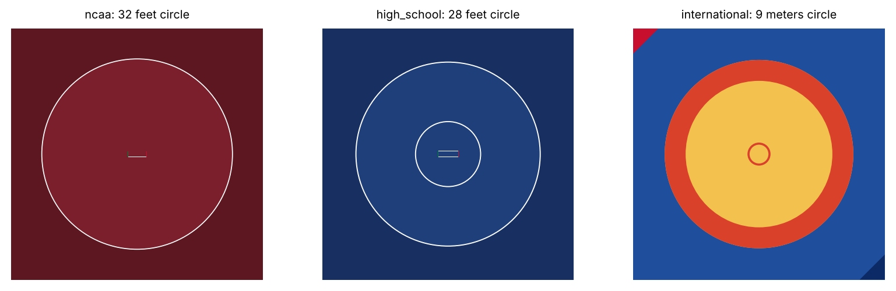
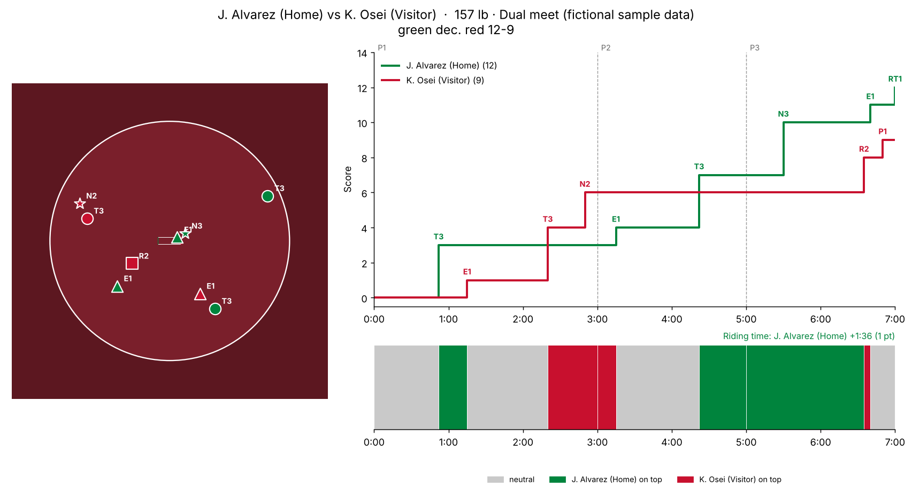
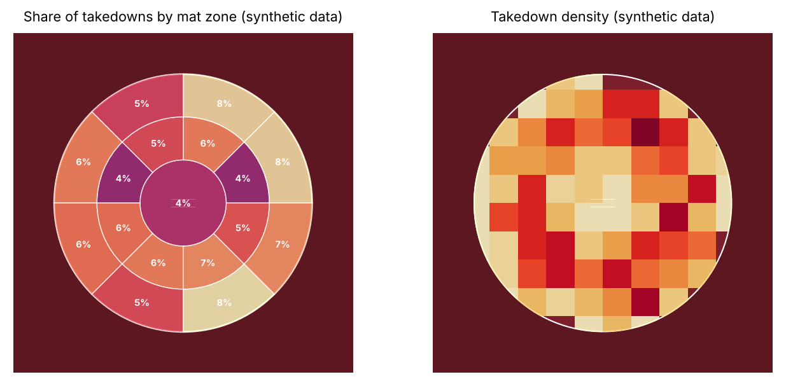

# mplwrestling

Matplotlib visualizations for wrestling, in the spirit of mplsoccer and hockey_rink: to-scale mats,
score timelines, top/bottom position strips, riding time, events on the mat and mat-zone heatmaps.





The match and the takedown locations above are made up, to show the charts.

## Install

```bash
pip install -e .            # from this folder
pip install -e ".[test]"    # plus pytest
```

## Quick start

```python
import mplwrestling as mw

mat = mw.WrestlingMat("folkstyle", units="feet")   # aliases map to ncaa / high_school / international
fig, ax = mat.draw()
mat.scatter([3, -8], [2, 5], color="gold")

match = mw.Match(wrestlers={"green": "Home", "red": "Visitor"}, rules="ncaa")
match.add("takedown", "green", period=1, clock="2:08", x=6, y=-9)
match.add("escape", "red", period=1, clock="1:45")
match.add("near_fall", "green", time=330, points=3)
print(match.final_score(), match.result(), match.riding_time())

mw.match_summary(match)
```

`python examples/gallery.py` regenerates the images above.

## Concepts

**Coordinates.** The origin is the centre of the mat. +x runs parallel to the scorer's table and +y
points away from it. Every value is in the units you created the mat with: any pint length unit, or
`"mat_units"`, which scales lengths so the edge of the circle is 1 on every style.

**Dimensions.** `mplwrestling.DIMENSIONS` holds each style's measurements as pint quantities. Change any
one with a keyword, e.g. `WrestlingMat("ncaa", competition_radius=21)` for a 42 ft circle. Build
anything else, such as a youth mat, with `WrestlingMat.custom(...)`. The converted values are in
`mat.dimensions` (quantities) and `mat.dims` (floats).

**Events.** A `Match` holds `Event`s with a time in seconds since the start (or use `period` and `clock`),
a type, the wrestler's corner, optional points and an optional `(x, y)` on the mat. For penalties and
stall warnings, `wrestler` is the offender. Each period starts neutral. A `position` event records a
choice (top, bottom or neutral). Takedowns and reversals put the scorer on top, and escapes return the
match to neutral. That timeline drives `position_strip` and NCAA riding time.

**Zones.** `mat.zone_of(x, y)` splits the mat into a centre, rings and sectors. `mat.zone_heatmap` shades
them. This is the zone-and-stance approach chosen for the first version, rather than precise body
tracking.

## Rule-book values and where they come from

| | NCAA | High school (NFHS) | International (UWW) |
|---|---|---|---|
| Competition circle | 32 ft min. (32 to 42 ft) | 28 ft min. | 9 m, including a 1 m red zone |
| Outside the circle | 5 ft min. | about 5 ft | 1.5 m protection area |
| Boundary line | 2 in, in bounds | 2 in (assumed same as NCAA) | red zone |
| Centre marking | none required | 10 ft circle, optional since 2024-25 | 1 m central circle |
| Starting lines | 3 ft down lines 10 in apart, green and red ends | assumed same as NCAA | none drawn |
| Periods | 3-2-2 min | 2-2-2 min | 3-3 min (not verified) |
| Points | T3 E1 R2 NF2/3/4, riding time point at 1:00 | T3 E1 R2 NF2/3/4, no riding time | pass points explicitly |

Sources, checked October 2026: [NCAA Wrestling Rules Book 2025-26 and 2026-27](https://ncaaorg.s3.amazonaws.com/championships/sports/wrestling/rules/PRMWR_RulesBook.pdf);
[high school vs college differences (2014-15)](https://ncaawrestling.arbitersports.com/Groups/107525/Library/files/Rules%20Differences%202014-15%20Final.pdf);
[NFHS 2024-25 rule changes](https://nfhs.org/resources/sports/wrestling-rules-changes-2024-25);
[UWW mat summary, WA sports dimensions guide](https://www.cits.wa.gov.au/sport-and-recreation/sports-dimensions-guide/wrestling).
Rows marked "assumed" or "not verified" still need a primary source.

The theme colours are not rule-book colours. Change them with `draw(mat_color=..., ...)`.

## Not built yet

- Animation of position sequences.
- Tournament brackets and dual-meet team scoring.
- Parsers for TrackWrestling and FloWrestling exports. Neither has a public API.
- Overtime periods, which are scored now but not labelled on the charts.
- International scoring rules beyond explicit points.
